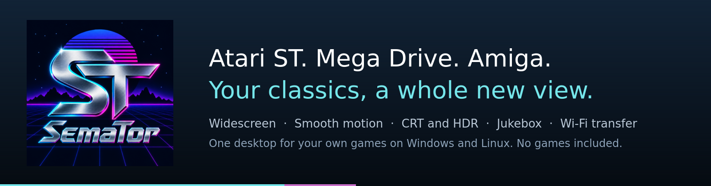

# SemaTor

**Atari ST, Mega Drive and Amiga. Your classics, a whole new view.**

SemaTor is one desktop for your own retro games on **Windows and Linux**. It runs **Atari ST** games, **Mega Drive / Genesis** games (SemaDrive) and, as an experimental preview, **Amiga** games (SemaBench). Many games get optional enhancements: **widescreen, smooth motion at your screen's refresh rate, sharper 3D, CRT looks and HDR**. Every enhancement starts off, is remembered per game, and the original game is always one switch away.

Bring your own games. None are included, and no Atari TOS ROM or Amiga Kickstart ROM file is needed. Feature support varies by game, edition and display hardware.

Created by David Baron with AI assistance in development, research, documentation and this website.

[Download the public preview](https://github.com/SirBaron/SemaTor/releases) · [Website](https://sirbaron.github.io/SemaTor/) · [Discord](https://discord.gg/DdHfSGrdFc) · [YouTube](https://www.youtube.com/@SemaTorST) · [Report a problem](https://github.com/SirBaron/SemaTor/issues)

**1.1.618 public preview: Windows x64, Linux x86-64, Linux ARM64 and Android.** This repository holds the website, public documentation and issue tracker. SemaTor's source is private. See the [release notes](./CHANGELOG.md) for what changed and the known limits. Thanks to eightiesjapan and Paul C for testing and sharing detailed reports.

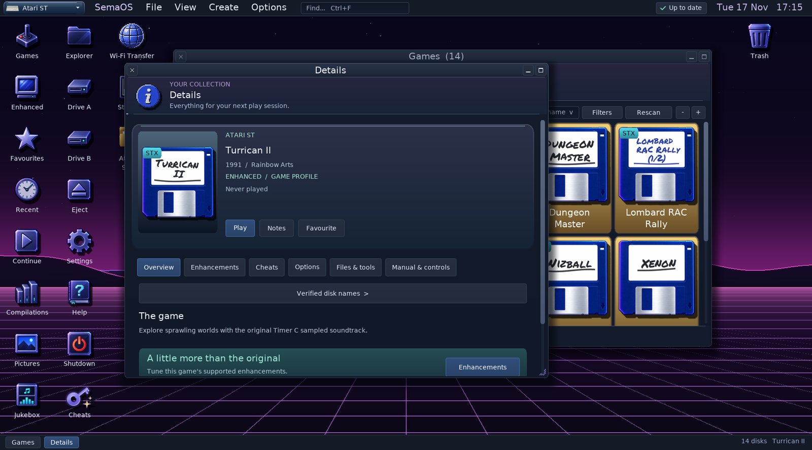
*SemaOS on the Atari ST home. Your own disks wear handwritten labels; no games are bundled.*

## Three systems, one home

Atari ST, Mega Drive and Amiga share one app. Each has its own desktop and look, and all share the same library, Jukebox, saved games, notes and Wi-Fi transfer. The app reopens the desktop you used last.

| Atari ST (SemaOS) | Mega Drive (SemaDrive) | Amiga (SemaBench preview) |
| --- | --- | --- |
| 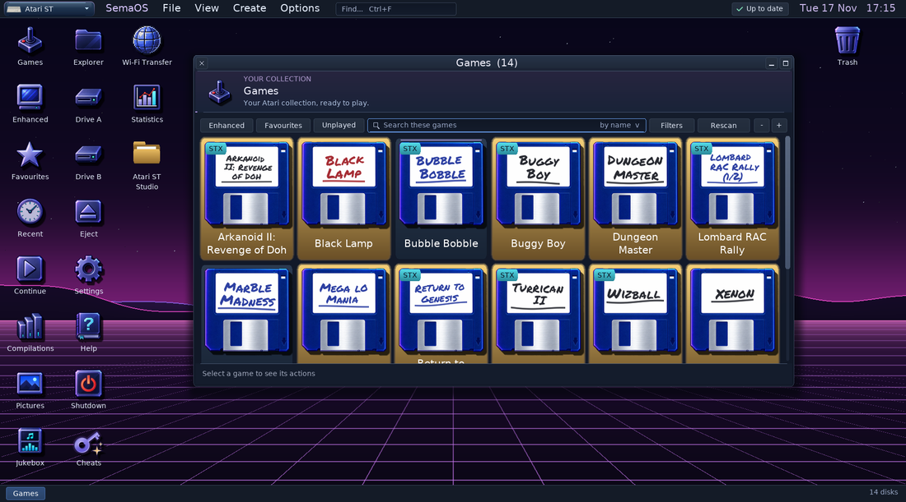 | 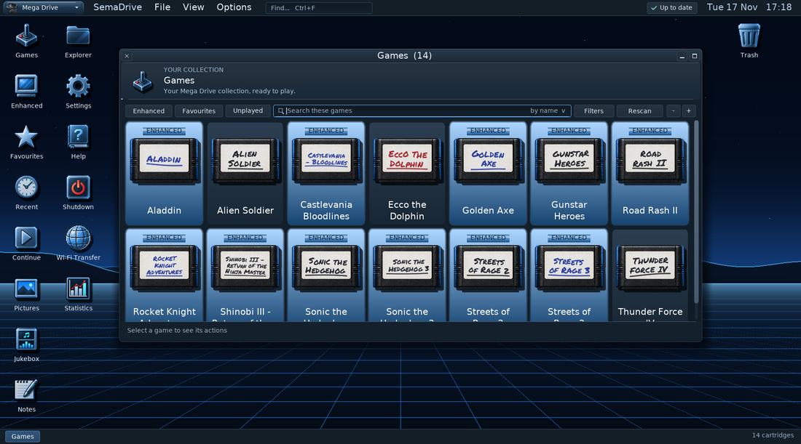 | 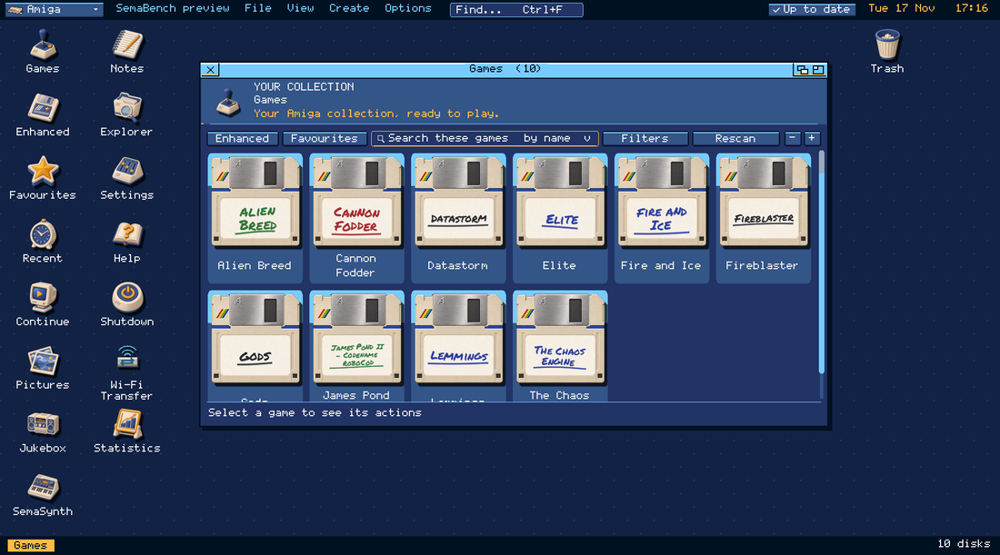 |
| The original. No TOS ROM needed. | Cartridges, with a coast or night scene. | An Amiga 500 with our own Kickstart replacement. Experimental: many games run, many do not yet. |

[More about SemaDrive](https://sirbaron.github.io/SemaTor/semadrive.html) · [More about SemaBench](https://sirbaron.github.io/SemaTor/amiga.html)

## Enhanced games

Enhancements are made game by game and checked against the original. A picture option never changes the game's logic or sound.

- **Widescreen:** real extra playfield, never a stretched picture. 16:9, 21:9 and up to 32:9 where the game allows it; fixed screens stay 4:3.
- **Smooth motion:** extra pictures between the game's own updates, matched to your display's refresh rate in supported games, plus frame generation and run-ahead.
- **Sharper 3D:** supported 3D games are redrawn on your graphics card at up to 4x resolution, with anti-aliasing and farther draw distance.
- **CRT and HDR:** bezels, scanlines, phosphor glow, and Auto HDR on compatible Vulkan/HDR setups.
- **Keep your place:** save states, rewind and per-game settings.

| | |
| --- | --- |
| 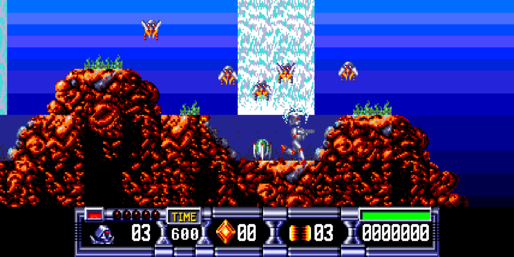 | 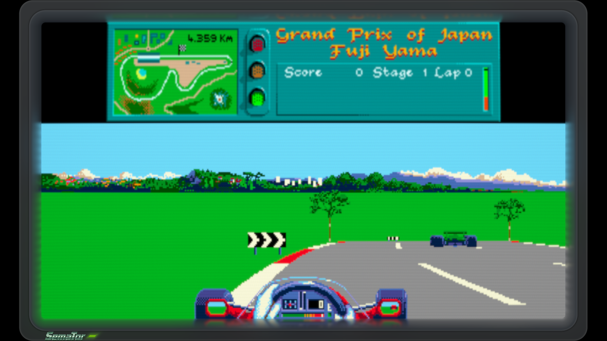 |
| *Turrican II (ST), widescreen.* | *Vroom (ST), CRT bezel.* |
| 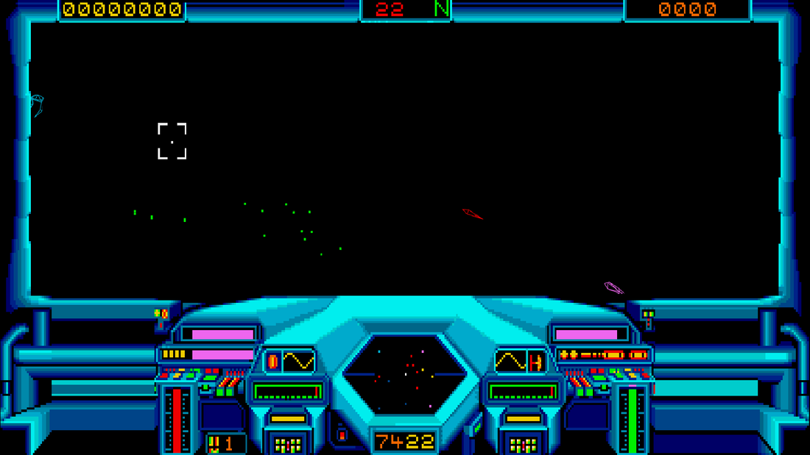 | 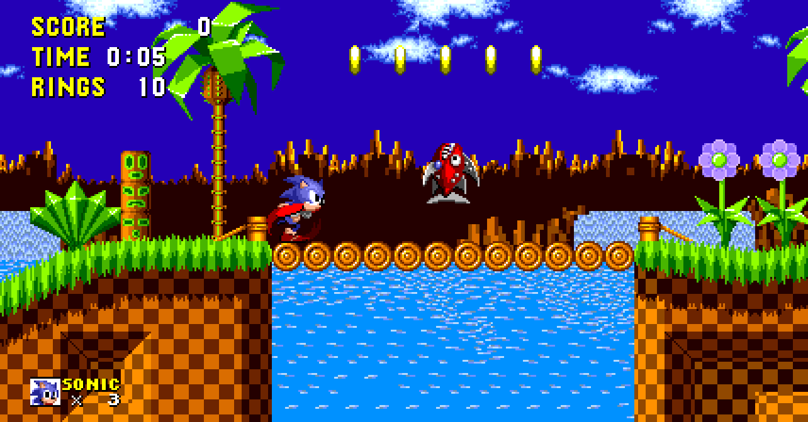 |
| *Starglider (ST), 4x resolution with anti-aliasing.* | *Sonic the Hedgehog (Mega Drive), widescreen.* |

[Browse every current game enhancement](https://sirbaron.github.io/SemaTor/games/index.html), searchable by game and feature, with cheats kept separate. Screenshots are real captures from the app; the pictures are the games' own and may be shown at a different size.

## Jukebox

One music player for all three systems: Atari ST (YM/SNDH), Mega Drive cartridges and Amiga disks and modules. Browse and search, shuffle, keep favourites, watch the visualiser, or minimise it into the menu bar. Nothing is bundled: it plays music found on the disks, cartridges and files you add. [See what is supported](https://sirbaron.github.io/SemaTor/jukebox.html).

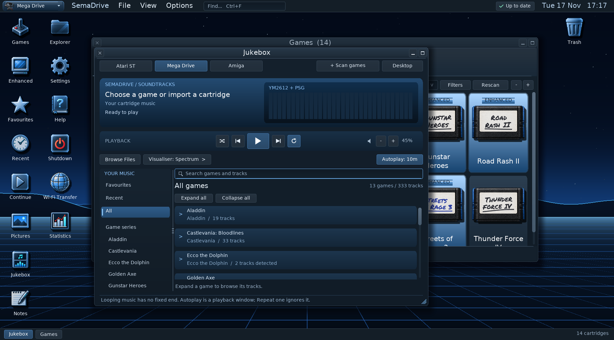
*The Jukebox on the Mega Drive desktop, with the example library from the screenshots.*

## Wi-Fi transfer

Send games and their saves from one desktop to another over your own network. Android phones join in with the same app. Pair by comparing six digits on both screens, pick games with filters (or all enhanced games), and choose what happens to saves that already exist. On the desktop it is a normal movable window, so the rest of SemaOS stays usable. Transfers are verified and resumable, but they are not encrypted: use a trusted network.

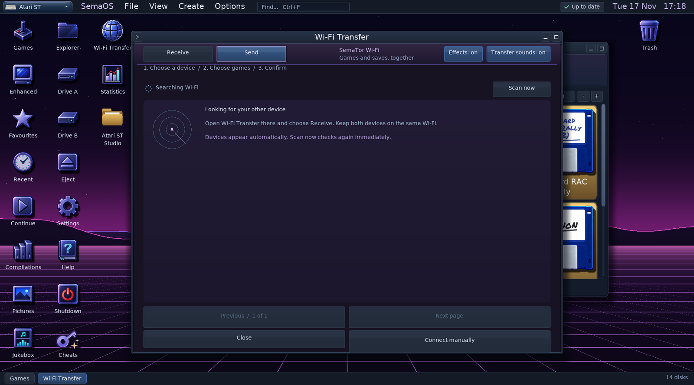
*Wi-Fi Transfer as a SemaOS window, looking for a nearby device.*

## SemaOS

SemaTor starts in **SemaOS**, a desktop of its own with Games, Enhanced, Favourites, Recent, Continue, Drives, Jukebox, Pictures, Notes and more. Use the mouse, the keyboard or a gamepad. Details shows play time, saves with pictures, notes, the profile and its enhancements and music for each game.

SemaOS also has creative tools: SemaPaint, SemaSynth, Maker and a 68000 Program Lab. [Explore the Creator tools](https://sirbaron.github.io/SemaTor/creator.html) to see how to build a native ST/STE game disk.

## Install the desktop preview

| Platform | Release attachment | Start here |
| --- | --- | --- |
| Linux x86-64 | `SemaTor-1_1_618-linux-public-preview.zip` | Extract, open a terminal in that folder and run `sh install.sh`. The default installation is `~/Games/SemaTor`. |
| Linux ARM64 | `SemaTor-1_1_618-linux-aarch64-public-preview.zip` | Extract and run `sh install.sh`; Python 3 is required. |
| Windows x64 | `SemaTor-1_1_618-windows-public-preview.zip` | Extract the whole ZIP to a writable folder, then run `SemaTor.exe`. Keep `SDL3.dll` beside it. |

SemaTor carries its own SDL3. On Linux you only need Python 3 for the installer. Put your own games in **Games** (Atari ST), **MegaDrive** and **Amiga** beside SemaTor, or add folders from SemaOS. Keep your **Games**, **Media**, **User** and **Add-ons** folders when updating.

**Updating:** the button at the top right of the SemaOS menu bar shows **Up to date** or **Update available**. Select it to download, then **Install update and restart**. Signed updates keep your games, saves, settings and custom artwork. GitHub downloads stay available. If an older Windows interface is unreadable, extract the new ZIP over your installation, keeping Games, Media, User and Add-ons.

**Bring your own games.** Atari ST disk images (ST, IMG, MSA, DIM, STX, or inside ZIPs), Mega Drive cartridge images and Amiga ADF/IPF disks. Most ST disks run; if one does not, please report it. This is a preview series: Linux has had hands-on testing; Windows has been built and checked automatically but still needs broader real-machine testing. SemaBench (Amiga) is experimental and its compatibility varies by game.

The optional Dungeon Master artwork add-on is shared on the [SemaTor Discord](https://discord.gg/DdHfSGrdFc); extract its ZIP into the SemaTor folder. Its native interface is still experimental.

## Phones and handhelds

The **Android APK** (arm64) is attached to each [GitHub release](https://github.com/SirBaron/SemaTor/releases) beside the desktop downloads. Download the `.apk` file and install it on your phone or handheld (Android asks you to allow installs from your browser or file manager). It is a public preview: performance depends on the device, and it is not on Google Play yet. Talk about Android on [Discord](https://discord.gg/DdHfSGrdFc).

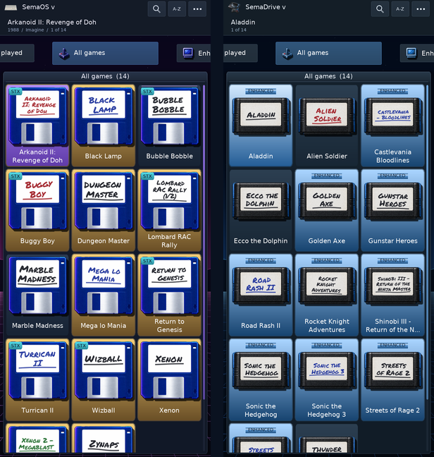
*Phone interface, development preview, with example library entries.*

## Help improve compatibility

In SemaOS, right-click a game (or open its Details) and choose **Report a problem**. It opens a prefilled GitHub draft that you review and submit with your own GitHub account; no disks or logs are uploaded automatically.

Open a [bug or game report](https://github.com/SirBaron/SemaTor/issues). Include the SemaTor version, OS, GPU and driver, the game and the disk's name, steps to reproduce, relevant CRT, smooth-motion and sound settings, and the last version that worked if you know it. Screenshots help. An optional local report is under **F12 → Support & diagnostics**; review it before attaching. Please do not upload game disks or ROMs.

## Credits and licence

SemaTor © 2026 David Baron. All rights reserved; see [LICENSE](./LICENSE). Third-party notices are included under `Media/licenses` in the public builds. Atari, Atari ST, Sega, Mega Drive, Genesis and Amiga are trademarks of their respective owners. SemaTor is not affiliated with or endorsed by them.
